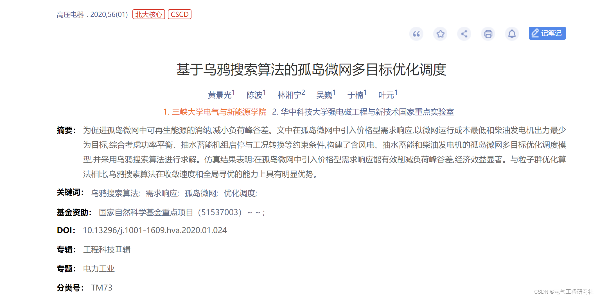
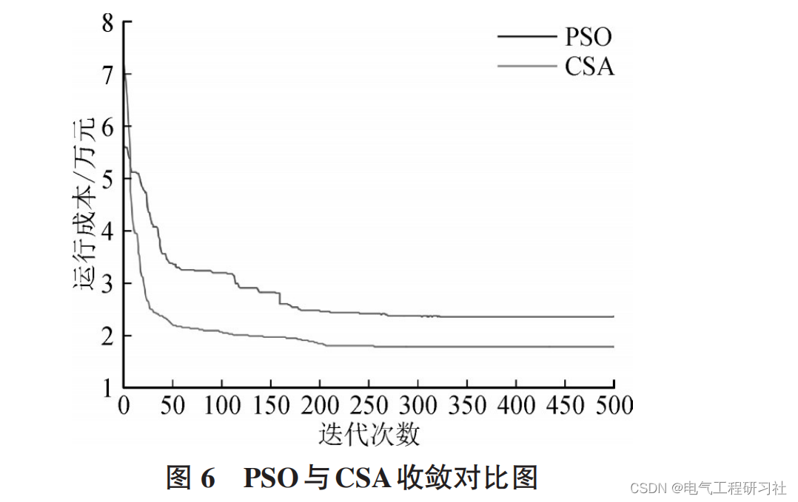
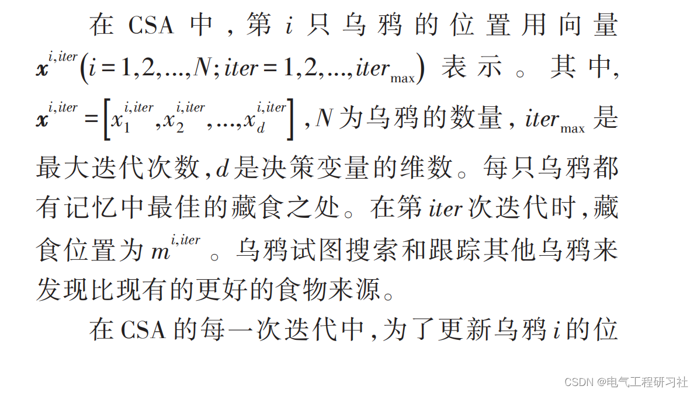
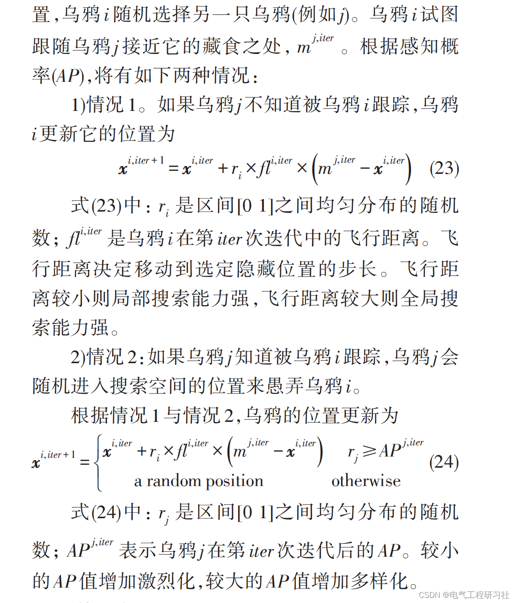
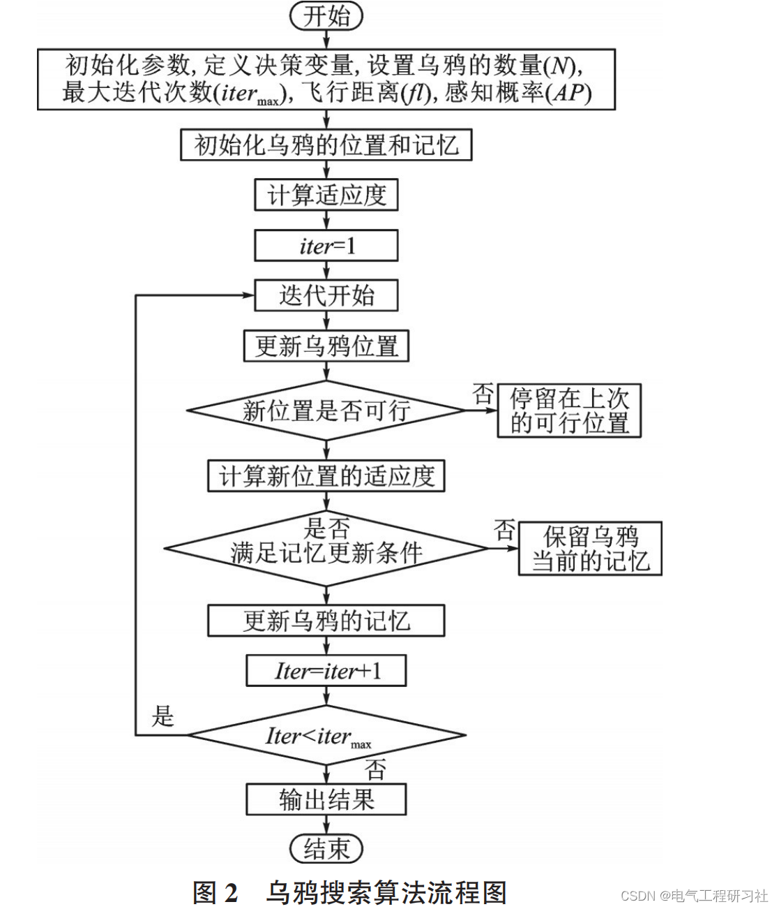
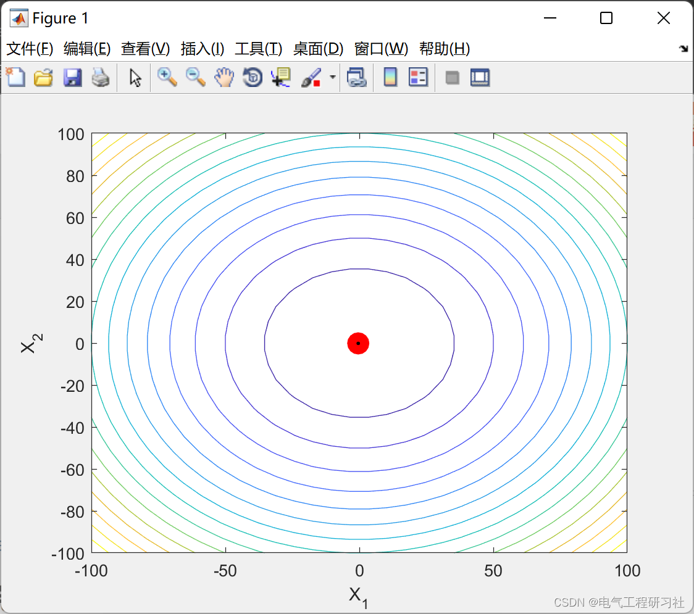
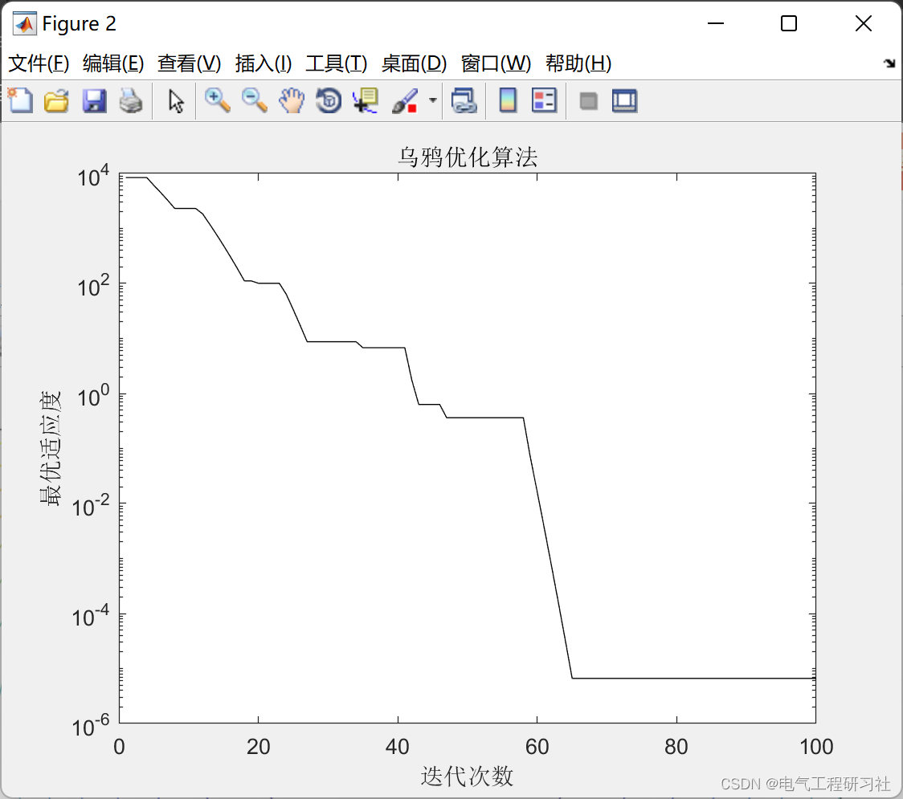
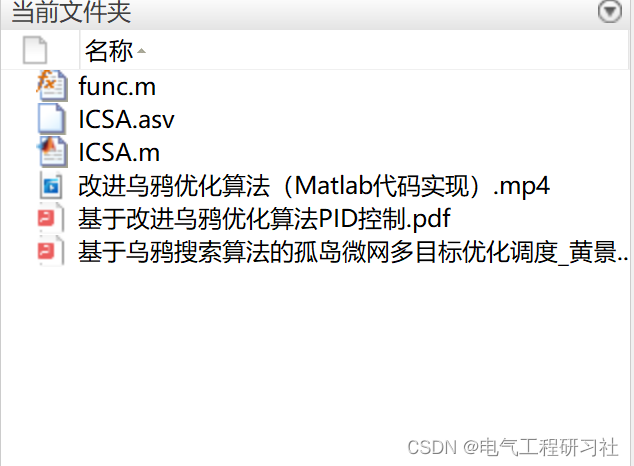

# PID Control Based on Improved Crow Optimization Algorithm (Matlab Code Implementation)

​  
Editor
The improved Crow Optimization Algorithm is much stronger than the Particle Swarm Optimization Algorithm:
Editor
This article's table of contents is as follows: ⛳️⛳️⛳️Table of Contents 1. Introduction to the Algorithm 2. Mathematical Model 3. Algorithm Steps 4. PID Control Based on an Improved Crow Optimization Algorithm 5. MATLAB Complete Code Implementation 5.1 Run Results 5.2 MATLAB Code 6. Final Thoughts
2 Mathematical Models - Editing The algorithm steps are as follows:
1) Initialize parameters. Define decision variables. Set the number of crows (N). Maximum number of iterations (iter max.) Flight distance (t), Initialize the position and memory of the crow. N black crows are randomly distributed in a d-dimensional search space. In the first iteration, Assume the crow hides the food at its initial position. 3) Evaluate the fitness (target) function. Calculate the objective function value corresponding to each crow. 4) Update the location of the crows. Generate new positions based on equation (23). 5) Detect the feasibility of new locations. Test the feasibility of each crow's new location. If the new location for the crows is feasible. The crow will update its location.Otherwise, crows will remain at their current position and not move to a new one. 6) Evaluate the fitness function for the new position. Calculate the fitness function value for each crow's new position. 7) Update memory. If the fitness function value of the crow's new position is better than that of its memory position, the crow updates its memory through the new position. 8) Iteration termination condition. Repeat steps 4)-7) until the maximum number of iterations is reached. When the termination condition is met, output the position corresponding to the optimal target function value.
4. Improved Crow Optimization Algorithm-Based PID Control
Download link: Iraqi Academic Scientific Journals - IASJ
5. Matlab Complete Code Implementation
5.1 Video of Run Result:
PID Control Based on Improved Crow Search Algorithm F (Matlab Code Implementation)
Edit
Edit
5.2 MatlabCodetic\nclc\nclear all\nclose all\nrng default\nformat long\nLB=[-100 -100];\nUB=[100 100];\n\n%% ICSA parameters\n\nPd=2;                              % Number of variables\nN=1;                               % Total group count\nfl=1.2;                            % Flight Length (fl)\nAP=0.3;                            % Cognitive Probability\nmaxite=100;                       % Maximum number of iterations\nmaxrun=1;                          % Set the maximum number of runs required\nwmax=0.9;                          % Inertia weight\nwmin=0.2;                          % Inertia weight\nshow_val=1;                        % Control drawing 1 Draw motion 0 Other not draw\n\n%% Draw borders for particle motion\nif show_val==1\nfigure\nset(gcf,'Renderer','OpenGL');\nx = linspace(-100,100,30);\ny = linspace(-100,100,30);\n[x_new, y_new] = meshgrid(x,y);\n\nfor k1 = 1: size(x_new, 1)\n    for k2 = 1 : size(x_new , 2)\n        X = [ x_new(k1,k2) , y_new(k1, k2) ];\n        z(k1,k2) = func( X );\n    end\nend\n\nh = contour(x_new, y_new, z , 15);\nset(gca,'XLimMode','manual');\nset(gca,'YLimMode','manual');\naxis([-100,100,-100,100]);\nxlabel('X_1');\nylabel('X_2');\nhold on\nview(2)\nshading interp\nend\n\n%% ICSA \nfor run=1:maxrun\n    run\n    for i=1:N\n        for j=1:Pd\n            x0(i,j)=LB(j)-(LB(j)-UB(j))*rand();  % Initialization\n        end\n    end\n    x=x0;                                        % Initialize the population\n    \n    for i=1:N\n        f0(i,:)=func(x0(i,:));\n        [fmin0,index0]=min(f0);\n    end\n    \n    mem=x0;                % Initialize individual optimal\n    fitmin=x0(index0,:);   % Initialize global optimal\n    \n    %% Draw the first position\n    if show_val==1\n    for i=1:N\n        h1(i) = plot(x0(i,1),x0(i,2),'or', 'LineWidth',7.5,'markerFaceColor','r');\n        p1 = [x0(i,1) x0(i,2)];                                            % First dot\n        p2 = [x(i,1) x(i,2)];                                              % Second point\n        dp = p2-p1/100;                                                    % Differences\n        h2(i) = plot([p1(1) dp(1)],[p1(2) dp(2)],'.k' ,'LineWidth',1.5);   % Movement's shadow\n    end\n    end\n    \n  \n    ite=1;\n    tolerance=1;\n    while ite<=maxite && tolerance>10^-12\n        \n        w(ite)=wmax-(wmax-wmin)*ite/maxite;                                % Update inertia weight\n        num=ceil(N*rand(1,N));                                             % Generate a random candidate crow to track (chased)\n        \n        for i=1:N\n            if rand>=AP\n                x(i,:)=w(ite)*x(i,:)+fl*rand*(mem(num(i),:)-x(i,:));       % Inertia weight * is used to generate a new position (state 1) for the crow i.\n            else\n                for j=1:Pd\n                    x(i,j)=LB(j)-(LB(j)-UB(j))*rand;                       % Generate a new location for the crow i (state 2)\n                end\n            end\n        end\n        \n        %% Handle behaviors that violate boundaries.\n        for i=1:N\n            for j=1:Pd\n                if x(i,j)<LB(j)\n                    x(i,j)=LB(j);\n                elseif x(i,j)>UB(j)\n                    x(i,j)=UB(j);\n                end\n            end\n        end\n        \n        %% Calculate suitability\n        for i=1:N\n            f(i,:)=func(x(i,:));\n        end\n        \n        %% Update pbest and the minimum fitness value.\n        for i=1:N\n            if f(i,1)<f0(i,1)\n                mem(i,:)=x(i,:);\n                f0(i,1)=f(i,1);\n            end\n        end\n        [fmin,index]=min(f0);       % Find the optimal particles\n        ffmin(ite,run)=fmin;        %Store the optimal fitness\n        ffite(run)=ite;             %Store the number of iterations\n        \n        %% Update the optimal solution and optimal fitness\n        if fmin<fmin0\n            fitmin=mem(index,:);\n            fmin0=fmin;\n        end\n        \n        %% The drawing position will run.\n        \n        if show_val==1\n        for i=1:N\n            nn = 50;                                       % Speed control of drawing\n            moving_x(i,:) = linspace(x0(i,1),x(i,1),nn);   % Shadow length (previous position - current position)\n            moving_y(i,:) = linspace(x0(i,2),x(i,2),nn);\n        end\n        \n        for rr = 1: nn\n            for JJ = 1:N;\n                set(h1(JJ),'XData', moving_x(JJ,rr),'YData', moving_y(JJ,rr));\n                p1 = [moving_x(JJ,rr) moving_y(JJ,rr)];                    % First dot\n                p2 = [moving_x(JJ,end) moving_y(JJ,end)];                  % Second point\n                dp = (p2+p1)/2;                                            % Different\n                dp = (p1+dp)/2;\n                set(h2(JJ),'XData', [p1(1), dp(1)],'YData',  [p1(2), dp(2)]);\n            end\n            drawnow                                                        % Execute the update of the drawing will run\n        end\n        x0=x;                                                              % Save the previous position\n        end\n        \n        %% Calculation Error\n        if ite>5000;\n            tolerance=abs(ffmin(ite-50,run)-fmin0);\n        end\n        \n        %% Iteration results\n        if ite==1\n            fprintf('Iterative Optimal Particle Objective Fitness\n');\n        end\n        fprintf('%8g %8g %10.8f\n',ite,index,fmin0);\n        ite=ite+1;\n        \n    end\n        %% ICSA \n        fvalue=func(fitmin);\n        fff(run)=fvalue;\n        rgbest(run,:)=fitmin;\n        fprintf('--------------------------------------\n');\n    \nend\n%% Result\nfprintf('\n\n');\nfprintf('*********************************************************\n');\nfprintf('Result-----------------------------\n');\n[bestfun,bestrun]=min(fff)\nbest_variables=rgbest(bestrun,:)\nfprintf('*********************************************************\n');\n\n%% ICSA convergence characteristics\nfigure(2)\nsemilogy(ffmin(1:ffite(bestrun),bestrun),'-k');\nxlabel('Iteration count');\nylabel('Optimal fitness');\ntitle('Crow Optimization Algorithm')\n%##########################################################################\ntoc\n  
function ft=func(x)\n    ft=sum(x.^2);    % Target function, you can replace it with the target function you need\nend\n  
For the complete download of the paper and code, please see:
Editor
6. References to theoretical literature in the final section, if any infringement, please contact the blogger for removal.

## Images

<!-- PAYMENT_BLOCK -->

## Get this dataset

- Payment link (Stripe): [Buy now](https://buy.stripe.com/3cs8yP7sY87d0vu9AB)
- Payment QR code: 

<!-- /PAYMENT_BLOCK -->
